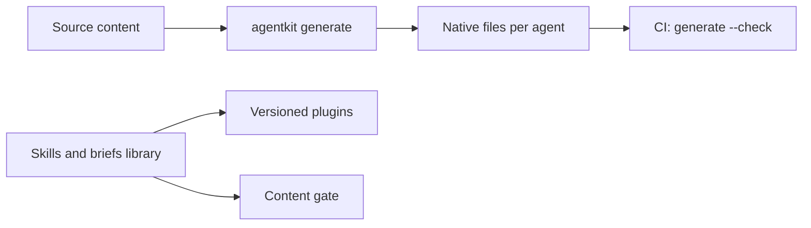

# Agent kit

A command-line tool and a content library that give AI coding agents their instructions, skills and guard rails in a repository, written once and generated for each agent.

## What it does

- Keeps agent content in one source folder (instructions, skills, subagents, commands, hooks and MCP server entries) and generates each agent's native files from it: Claude Code, GitHub Copilot, Cursor, JetBrains Junie and the cross-tool `AGENTS.md` file.
- Validates every item against a JSON Schema and enforces size budgets, such as skill description length and the total skill metadata an agent advertises.
- Lints the hand-written agent files of any repository (`doctor`) and can fix findings in place.
- Inspects a target repository, detects which agents it uses, and installs or re-syncs a set of upkeep skills into it, with a dry run and conflict reconciliation.
- Ships general skills (CI/CD, documentation, development, QA, design) as versioned Claude Code plugins, and composes layered briefs (a shared base, per-account tiers, per-surface files) for each environment an agent runs in.

## How it is built

- The CLI is TypeScript on Node.js, built with pnpm, using Commander, Ajv for schema validation and js-yaml; tests run on Vitest with property tests from fast-check.
- Output is byte-stable, so CI fails when committed files drift from their source.
- Plugin scripts and hooks are dependency-free TypeScript run directly by Node; CI checks scripts, hook manifests and that every plugin change bumps its version.
- A content gate renders every surface's brief and checks word budgets, description and body length, missing skill references and banned phrasing. The gate and the brief-composing service are separate components.
- Optional behavioural evals (promptfoo and golden cases) check that the right skill fires and its nearest sibling stays quiet.

## Status

The CLI is at version 0.1.0 and is not published to a package registry. The repository applies the kit to its own agent files and checks them in CI.
